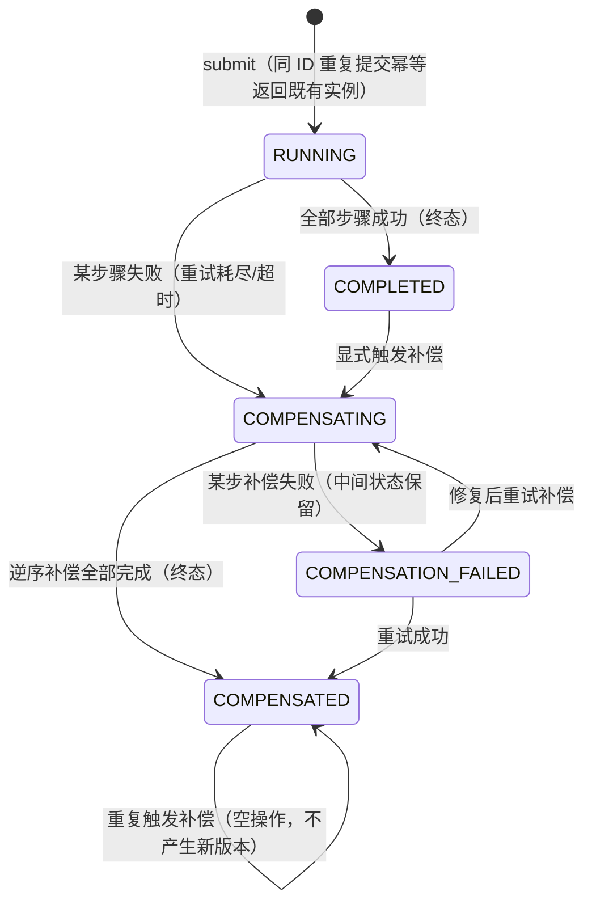

# Saga Orchestrator Java（本地可验证分布式事务编排组件）

基于 **Java 21 + Spring Boot 3.4 + 本地存储（内存 / 本地文件 JSON）** 实现的一套
Saga 编排组件。不依赖数据库、消息队列等外部中间件，所有保证都可以通过
`mvn test` 在本地直接验证；配置文件目录后还可真实演示“组件重启 / 重新初始化后
继续推进未完成实例”。

---

## 1. 能力概览

| 需求 | 实现方式 |
|---|---|
| 顺序编排多个步骤，每步登记补偿 | `SagaDefinition` 持有有序 `SagaStep` 列表，每步含正向动作 + 可空补偿动作 |
| 正向中途失败，已成功步骤按**逆序**补偿 | 正向失败立即切换到补偿状态机，从最高位成功步骤逆序执行补偿 |
| 补偿失败不丢中间状态，待补偿/补偿中/补偿失败可区分 | 步骤状态机 `COMPENSATION_PENDING → COMPENSATING → COMPENSATION_FAILED / COMPENSATED`，失败处停止，更早步骤保持 `COMPENSATION_PENDING` |
| 重复补偿幂等 | `COMPENSATED` 终态重复触发是空操作（版本不增长）；`COMPENSATION_FAILED` 重试只继续未完成部分，已 `COMPENSATED` 步骤不再触碰 |
| 同一业务实例重复 / 并发提交收敛唯一终态 | 业务实例 ID 即幂等键；进程内按实例分段锁串行 + 存储层 `insertIfAbsent` / CAS |
| 步骤重试与超时确定 | `RetryPolicy`（最大尝试次数 + 退避）、`TimeoutPolicy`（虚拟线程 + Future 超时判定） |
| 重试不造成步骤重复生效 | 每次新尝试分配新 `executionId`；**在途尝试**（outcome 未知）崩溃恢复时复用同一 `executionId` 复查，业务动作凭该键去重 |
| 非法跳转 / 未知实例 / 并发冲突明确拒绝，原因可区分 | `RejectReason`：`UNKNOWN_INSTANCE` / `ILLEGAL_TRANSITION` / `CONCURRENT_CONFLICT` |
| 重启 / 重新初始化后继续推进 | `FileSagaRepository` 原子落盘 JSON 快照；启动时 `ApplicationReadyEvent` 触发 `recoverAll()` |
| 恢复不重复执行已完成步骤，不跳过补偿 | 终态实例跳过；`SUCCEEDED` 步骤跳过正向；`COMPENSATED` 步骤跳过补偿；在途标记驱动复查 |
| 可解释的状态与轨迹查询 | `GET /sagas/{id}`、`GET /sagas/{id}/trace`，轨迹记录每次提交、状态迁移、尝试结论与判定依据 |

---

## 2. 状态机

### 2.1 实例级状态 `InstanceStatus`



- **终态**：`COMPLETED`、`COMPENSATED`。恢复器不触碰终态。
- `COMPENSATION_FAILED` **不是终态**：可以（手动或恢复）继续推进。

### 2.2 步骤级状态 `StepStatus`

正向：

```
PENDING → RUNNING → SUCCEEDED（补偿已登记）
                  → FAILED（重试耗尽；该步骤未产生效果，不补偿）
```

补偿（仅正向 `SUCCEEDED` 的步骤进入）：

```
SUCCEEDED → COMPENSATION_PENDING（待补偿）→ COMPENSATING（补偿中）
          → COMPENSATED（补偿成功，终态，不可再重复执行）
          → COMPENSATION_FAILED（补偿失败，可幂等重试）
```

> 失败步骤本身及其后未执行步骤**不参与补偿**。补偿从最高位已成功步骤开始，严格逆序。

---

## 3. 幂等与“不重复生效”规则（核心）

### 3.1 三个幂等层级

1. **实例提交幂等**：`instanceId` 是业务幂等键。
   - 同 ID 已存在：直接返回既有实例，**不创建、不执行**。
   - 16 线程并发提交同一 ID：只有一个线程创建并执行，其余等待锁后收敛到同一终态。
2. **补偿触发幂等**：
   - 对 `COMPENSATED` 触发补偿：纯空操作，存储版本不增长；
   - 对 `COMPENSATION_FAILED` 触发：只补未完成部分，已 `COMPENSATED` 步骤不再调用补偿动作。
3. **动作执行幂等**（业务契约）：动作接口接收 `executionId`，业务侧必须以它为去重键：
   - **新尝试**（重试 / 新一轮补偿）→ 生成**新** `executionId`；
   - **在途复查**（崩溃恢复）→ **复用同一** `executionId`，保证“至多一次生效”。

### 3.2 在途标记（In-Doubt Marker）与恢复协议

每次动作调用严格遵循“**先落盘标记，再执行，再落盘结论**”：

1. 生成 `StepAttempt(attemptNo, executionId, outcome=null)`，步骤置 `RUNNING` / `COMPENSATING`，**CAS 落盘**；
2. 调用业务动作（独立虚拟线程执行，超时可确定判定）；
3. 用 `SUCCESS / FAILED / TIMEOUT` 替换标记并落盘。

若进程在 1 与 3 之间死亡，磁盘上留下 `outcome=null` 的在途标记。恢复时：

- **不允许新开尝试**，必须找到该标记并用**相同的 executionId** 复查；
- 复查成功 → 步骤完成，后续继续；
- 复查确定失败 → 才按重试策略分配新 attemptNo / executionId。

因此“已确认完成的步骤恢复时绝不重复执行；崩溃在途的步骤不会被新开尝试覆盖”。

### 3.3 并发控制

- **进程内**：按 `instanceId` 哈希到 64 段 `ReentrantLock`，同一实例的提交 / 补偿 / 恢复串行。
- **存储层**：所有写操作是乐观版本 CAS。`FileSagaRepository` 更新前重新读盘比对版本，
  版本不一致抛 `CONCURRENT_CONFLICT`，绝不静默覆盖。
- 文件写入：临时文件 + 原子 `move`，读取永远得到完整快照。

---

## 4. 重试与超时

- `RetryPolicy(maxAttempts, backoff)`：`maxAttempts=1` 不重试；超过 1 的尝试在调用前 sleep `backoff`。
- `TimeoutPolicy(timeout)`：动作在独立虚拟线程执行，`Future.get(timeout)` 超时判定为
  **`TIMEOUT`（结论不确定，动作可能已生效）**，取消执行线程，后续重试依赖业务幂等。
- 每个 `SagaStep` 可分别配置正向 / 补偿的重试与超时（`StepPolicies`）。

轨迹中每次尝试都记录 `ATTEMPT_DISPATCH`（含 executionId、是否崩溃复查）与
`ATTEMPT_RESULT`（SUCCESS / FAILED / TIMEOUT + 原因）。

---

## 5. 本地验证方法

### 5.1 单元测试（无需任何外部服务）

```bash
mvn test
```

覆盖 21 个测试（共 11 个场景），并发用例使用真实线程池 + CountDownLatch：

| 测试类 | 覆盖场景 |
|---|---|
| `HappyPathTest` | 正常顺序完成 |
| `CompensationFlowTest` | 中途失败、严格逆序补偿 |
| `CompensationFailureTest` | 补偿失败中间态保留（待补偿/补偿中/补偿失败）、修复后幂等重试、终态重复触发空操作 |
| `SubmitConcurrencyTest` | 重复提交、16 线程并发提交收敛唯一终态、步骤只生效一次 |
| `CompensationConcurrencyTest` | 12 线程并发触发补偿收敛，补偿动作只被调用一次 |
| `RetryTimeoutTest` | 失败重试后成功（生效一次）、确定的超时判定与新 executionId 重试 |
| `RejectionReasonTest` | `UNKNOWN_INSTANCE` / `ILLEGAL_TRANSITION` / `CONCURRENT_CONFLICT` 三类拒绝可区分 |
| `RecoveryTest` | 正向在途崩溃复查（复用 executionId）、终态恢复跳过、`COMPENSATION_FAILED` 重新初始化后继续 |
| `CompensationRecoveryTest` | 补偿在途崩溃恢复，不错过也不重复补偿 |
| `FilePersistenceRecoveryTest` | 基于临时目录文件存储，全新对象“重启”后读状态、继续补偿、终态幂等 |
| `SagaWebApiTest` | HTTP 状态/轨迹查询，404 / 409 + reason 区分拒绝原因 |

测试日志（控制台 + surefire 报告）会打印：**输入参数、每个步骤的状态迁移、
每次尝试的 executionId/结论/判定依据**。

### 5.2 启动应用做 HTTP 冒烟

```bash
# 默认内存存储（saga.storage-dir 留空）
mvn spring-boot:run

# 文件存储（可跨重启恢复）
mvn spring-boot:run -Dspring-boot.run.arguments="--saga.storage-dir=./target/saga-data"
```

接口：

| 方法 | 路径 | 说明 |
|---|---|---|
| POST | `/sagas` | body：`{"instanceId":"ORD-1001","definitionName":"demo-order"}`，提交并执行 |
| GET | `/sagas/{id}` | 查询实例 / 步骤状态、版本、失败原因 |
| GET | `/sagas/{id}/trace` | 查询完整执行轨迹 |
| POST | `/sagas/{id}/compensate` | 幂等触发补偿 |

拒绝响应：未知实例 `404 reason=UNKNOWN_INSTANCE`；非法跳转 / 并发冲突
`409 reason=ILLEGAL_TRANSITION | CONCURRENT_CONFLICT`。

示例：

```bash
curl -s -X POST localhost:8080/sagas -H 'Content-Type: application/json' \
  -d '{"instanceId":"ORD-1001","definitionName":"demo-order"}'
curl -s localhost:8080/sagas/ORD-1001/trace
curl -s -X POST localhost:8080/sagas/ORD-1001/compensate
```

应用内置演示定义 `demo-order`（下单→扣库存→扣余额→发货，均带补偿）。

---

## 6. 代码结构

```
saga/
├── model/        # 状态枚举、策略记录、SagaInstance/StepState/StepAttempt/TraceEvent
├── action/       # SagaAction / Compensation 接口、SagaStep / SagaDefinition
├── store/        # SagaRepository + InMemory / File 实现（CAS + JSON 快照）
├── engine/       # SagaOrchestrator（状态机）、AttemptRunner（超时）、恢复器、注册表
├── web/          # REST 接口与拒绝原因异常映射
└── demo/         # 演示编排定义
```

### 核心扩展点

- 实现 `SagaAction` / `Compensation`：**务必对相同 `executionId` 幂等**。
- 每步通过 `StepPolicies` 指定重试次数、退避、超时。
- 需要真实中间件时，新增一个 `SagaRepository` 实现（JDBC / Redis 等）即可，
  状态机与幂等协议不变（契约：条件插入 + 版本 CAS）。
